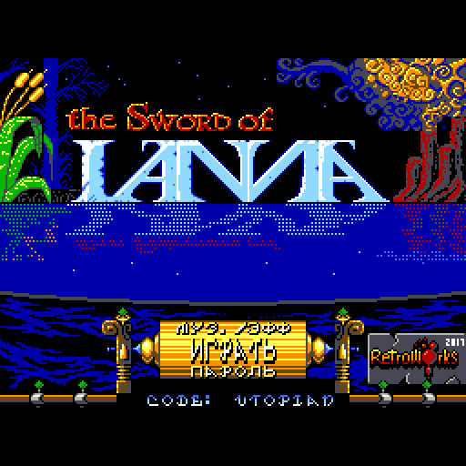
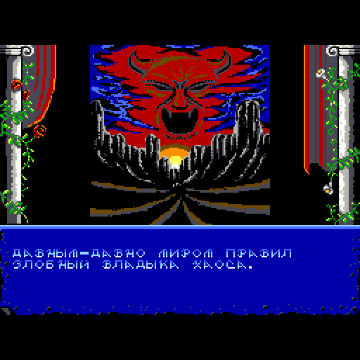
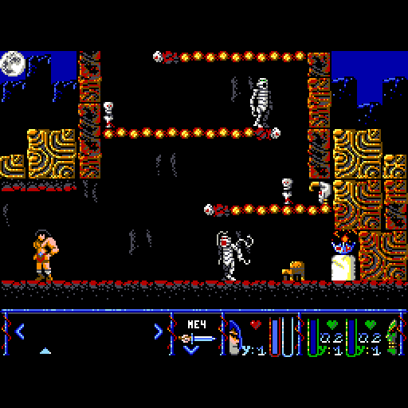
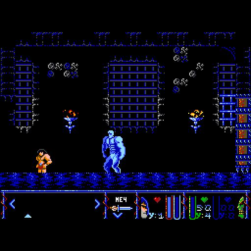
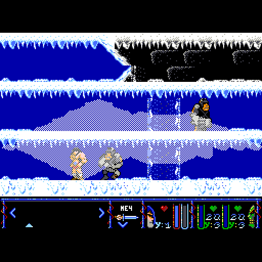
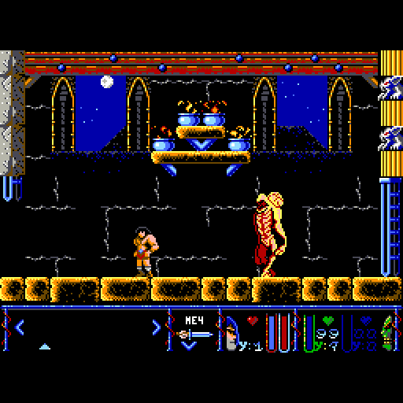

# The Sword of Ianna → Вектор-06Ц

Порт **The Sword of Ianna** (RetroWorks, 2017, MSX2) на **Вектор-06Ц**: КР580ВМ80А 3 МГц, 64 КБ ОЗУ,
квазидиск 256 КБ, дисковод, музыка и эффекты — через AY (порты `$14`/`$15`). Логика игры переведена из
Z80-исходника оригинала автоматически (`tools/z80to8080.py`) и сверяется с оригиналом тик в тик;
вывод, ввод, загрузка и звук написаны заново под Вектор. Русское издание: меню, вступление и тексты
уровней — по-русски.

| Меню | Вступление | Уровень 1 |
|---|---|---|
|  |  |  |

| Уровень 2: голем | Уровень 3 | Уровень 8 |
|---|---|---|
|  |  |  |

## Готовые образы

| Файл | Что это |
|---|---|
| [`rom/ianna.fdd`](rom/ianna.fdd) | **игра целиком**: загрузочная дискета 800 КБ (ROM, девять уровней, экран меню, слайды) |
| [`rom/ianna.rom`](rom/ianna.rom) + [`rom/ianna.edd`](rom/ianna.edd) | ROM с `0100h` и образ квазидиска с набором **первого уровня** — для эмуляторов и стендов без дисковода |

Дискета — основной способ запуска. На **MiSTer** (ядро Vector-06C): подключить `ianna.fdd` как дискету,
дождаться штатного ПЗУ и нажать **Alt+F11** (БЛК+СБР) — загрузка идёт с диска; на настоящем Векторе с
НГМД — то же самое. Уровни и слайды подгружаются с дискеты по ходу игры (набор уровня жмётся втрое и
распаковывается в квазидиск), поэтому дискета нужна всю игру.

ROM + EDD: ROM грузится с `0100h`, квазидиск заполняется образом `ianna.edd`. В нём лежит только набор
уровня 1 — переход на второй уровень без дискеты невозможен. Нужны квазидиск 256 КБ и AY; без AY игра
идёт молча.

## Управление

| действие | клавиши |
|---|---|
| движение, лестницы, прыжок | стрелки |
| удар мечом / огонь | **Z** или **пробел** |
| действие: взять, применить, поговорить | **X** (одно срабатывание на нажатие) |
| пауза и инвентарь | **H** — открыть; в нём стрелки — выбор, огонь — применить предмет, вниз — сменить оружие, **H** — назад, **X** — в главное меню |
| выход в меню | **СТОП** |
| музыка / эффекты, пароль уровня | пункты меню **МУЗ./ЭФФ** и **ПАРОЛЬ** |
| секретный девятый уровень | пароль `0CAFECAFE0` (как в оригинале): герой 2-го уровня, всё оружие, кроме клинка |

**Читы.** В меню нажать **F1+F3** — включается режим читов (действует до перезапуска). В игре:
**G** — бессмертие вкл/выкл, **L** — следующий уровень (с восьмого — на секретный девятый), **I** — показать на панели номер уровня и экран.

**Джойстик «П»** (ВВ55 №2, порт 06h, оба устройства) работает всегда, вместе с клавиатурой: направления —
стрелки, огонь 1 — удар, огонь 2 — действие; в меню и инвентаре — то же. Покой джойстика замеряется при
старте, нажатием считается отклонение от него. Порт 0Eh (джойстик «С») не читается.

## Как устроен порт

```
ref/msx2/src (оригинал, Z80)  ──z80to8080──▶  логика игры на i8080 (build/*_vec.asm)
                                                      + src/vec/ — экран, пул блитов, ввод, загрузка, плеер Arkos
ref/msx2/src (графика, карты, музыка) ──build_edd──▶ наборы уровней (квазидиск) ──build_levels/build_fdd──▶ rom/ianna.fdd
```

Экран Вектора 256×256×16 цветов вместо SCREEN 5: тайлы и спрайты собираются в **пул слотов** в квазидиске
и выводятся в видеопамять за один сброс, грязные стайлы — по двум колонкам, герой — позади луча.
Блиты идут с разрешёнными прерываниями (обработчик чинит два байта под SP по таблице), музыка — плеер
Arkos Tracker 1, переписанный под i8080 (поток AY совпадает с оригиналом 1:1). Все числа, тупики и
принятые решения — в журнале [docs/ANALYSIS.md](docs/ANALYSIS.md).

## Сборка

Нужны Python 3 (с Pillow) и ассемблер **sjasm** с ключом `--8080` (гейт «только команды i8080»): бинарник
кладётся в `tools/bin/sjasm`. Остальные утилиты и откуда они — в [tools/bin/README.md](tools/bin/README.md). Исходники оригинала (Apache 2.0) — клон
[fjpena/sword-of-ianna-msx2](https://github.com/fjpena/sword-of-ianna-msx2) в `ref/msx2`: из них берутся
логика, графика, карты и музыка. Релизный ROM оригинала в `ref/msx2_rom/ianna.rom` нужен только стендам сверки.

```sh
python3 tools/data/build_edd.py      # набор уровня 1: build/ianna.edd + build/gen_data.asm
python3 tools/build_vec.py           # ROM: build/ianna.rom (дважды, если build_edd менял gen_data.asm)
python3 tools/build_levels.py        # наборы всех уровней, сжатые: build/levels/level{N}.pak
python3 tools/build_fdd.py           # дискета build/ianna.fdd
```

`./build.sh` собирает эталонную MSX2-версию из `ref/msx2/src` (pasmo, apultra из `tools/bin`) —
она нужна только для сверки с оригиналом. `tools/build_vec.py --demo` — одиночный ROM без квазидиска
(демо-экран).

## Проверки

Стенды — headless-эмулятор i8080 с квазидиском (`tools/run_vec.py` на `tools/vendor/emu8080.py`, такты по
таблице, кадр 59904 тактов). Стенды с оригиналом (`lockstep.py`, `measure_msx.js`) идут на headless WebMSX
под Node.js: ядро `wmsx.js` и стабы окружения в репозиторий не входят — их кладут в `tools/msxemu/msxjs`
(или указывают каталог в `WMSX_DIR`), плюс `npm install jszip@2`. Сверке плеера (`tests/music`) нужен `pasmo`.

```sh
python3 tools/lockstep.py --level=2 --start=4,6 --route=none:30,left:40,fire+left:30   # порт против оригинала тик в тик
python3 tools/rtcheck.py build/ianna.rom build/ianna_vec.lst build/ianna.edd 4,5 --route=fight   # прерывания по тактам: артефакты
python3 tools/fddrt.py --strict --cheat          # загрузка с дискеты как на железе, меню, читы, смена уровня
python3 tools/bench_scenes.py --snap && python3 tools/bench_scenes.py   # скорость по 19 тяжёлым сценам
python3 tools/measure_vec.py build/ianna.rom build/ianna_vec.lst --start=4,5 --route=fight:300 --prof=40  # профиль тика
python3 tools/teartest.py build/ianna.rom build/ianna_vec.lst build/ianna.edd 4,6 --sprites       # разрывы перерисовки
node tools/msxemu/measure_msx.js --level=1 --start=4,6   # скорость оригинала на той же сцене
tests/music/check.sh                             # поток AY плеера против Z80-оригинала
```

Ещё: `tools/spwatch.py` (случайная игра со сторожами памяти), `tools/coverage.py` и `tools/deadcode.py`
(неисполняемый код), `tests/render/`, `tests/panel/`.

## Состояние

Восемь уровней и секретный девятый (по паролю), меню с паролями, вступление и концовка со слайдами, музыка и эффекты. Скорость — та же,
что у оригинала на MSX2: стоя и в бою 9,6–10 игровых кадров в секунду при полной скорости 10, в ходьбе
по тяжёлым сценам 8,5–9,5 (оригинал 9,2–10). На MiSTer проверены меню, загрузка с дискеты, игра на первых
уровнях, бой с големом и смена уровней 1→…→8 и секретный девятый; прохождение целиком на железе не проверялось.

## Источники и права

Оригинал — **The Sword of Ianna**, RetroWorks, 2017: код Utopian, графика Pagantipaco, музыка McAlby; исходники MSX2-версии — [github.com/fjpena/sword-of-ianna-msx2](https://github.com/fjpena/sword-of-ianna-msx2),
лицензия Apache 2.0. Порт на Вектор-06Ц — Борис Лихачёв, 2026; распространяется на тех же условиях — Apache 2.0
([LICENSE](LICENSE), что изменено и чьи сторонние файлы — в [NOTICE](NOTICE)). Графика, музыка и тексты принадлежат
авторам оригинала.
